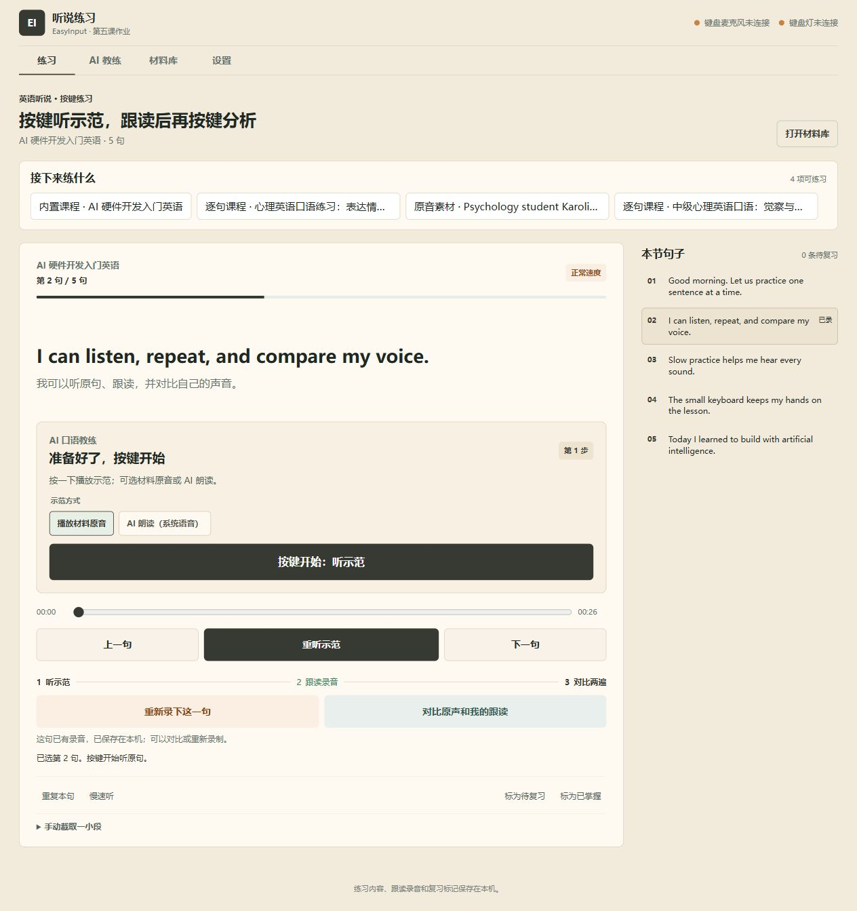

# EasyInput 桌面复读机

第五节课软硬件作业：用 EasyInput V2 开发板和本机浏览器完成英语听说训练。

作业过程、测试证据与后续实板验收安排见 [第五课作业报告](HOMEWORK-REPORT.md)。

## 启动

Windows 安装 Node.js 20 或更新版本后，双击 `start.cmd`。也可以在此目录运行：

```powershell
npm start
```

浏览器访问 <http://127.0.0.1:8766>。课程、许可明确的网络素材、逐句配音和跟读录音统一保存在本机材料库；“设置”里可查看目录并迁移全部文件。使用 DeepSeek 等在线教学模型或网络素材搜索时，相关请求会发送到所选服务。

“设置”中还可单独配置 OpenAI 兼容云端语音识别服务。跟读录音写入本机材料库后，可发送到所选服务转写；页面依据识别文本提示漏词和替换词，并将结果关联到录音。语音识别 Key 与教学模型、语音合成 Key 分开配置。仅有通用语音转写时，反馈是词句识别对比，不是音素或口音的专业评分。云端转写接口已有模拟测试，真实账户调用仍需有效服务 Key 验收。

启动脚本会固定使用 `8766`，避免与训练营其他本地项目的 `8765` 端口混淆。若端口被占用，可在 PowerShell 中临时设置 `EASYINPUT_REPEATER_PORT` 后运行 `node server.mjs`。

## 示例练习

打开页面即可练习内置的五句课程。点“AI 教练”并填写学习目标，工作流会检索英文文字、图片、音频和视频，归档许可明确的素材，生成逐句课程和语音。新课程会自动出现在“练习”的待练列表；点击课程后按练习按钮听示范、跟读、听反馈。也可以在“材料库”打开已导入素材。



### 使用本机 IndexTTS 2.5

如果电脑已安装 Yovoice IndexTTS 2.5 模型（通常在 `%USERPROFILE%\.yovoice\models`），可在其桌面应用的“设置 → 常规 → 本地 API”开启服务，记下地址与令牌。然后在本应用“设置 → 语音模型 · IndexTTS 2.5”选择 Yovoice，填本机地址和令牌，点“连接并读取模型”，选模型及参考声音，最后保存选择。令牌只保存在当前页面内存，不写入材料库或浏览器存储。若 Yovoice 未连接，课程仍会保存，但页面会明确提示逐句语音未生成；可回到课程重试。

当前安装的 Yovoice 版本和本机 API 监听状态仍需在实机确认。测试使用模拟 API 已验证课程发布会逐句生成 WAV 并自动加入练习；只有在接口实际连通后才能确认真实模型配音。

## EasyInput 实体键

配置模板位于 `easyinput-repeater-profile.json`。先在 EasyInput 配置中填入本机当前 IPv4 地址、2.4 GHz Wi-Fi 名称和密码，再导入设备配置。模板中的 `192.0.2.10` 是不能用于实际联调的示例地址，必须替换为 `ipconfig` 显示的电脑当前 Wi-Fi IPv4 地址。Wi-Fi 凭据只填在自己的本机配置中，不要上传填过凭据的配置文件或截图。

| 控件 | 功能 |
| --- | --- |
| S1 / KEY1 | 上一句 |
| S2 / KEY2 | 下一句 |
| S3 / KEY3 | 设置 A 点 |
| S4 / KEY4 | 设置 B 点 |
| S5 / KEY5 | 按当前练习状态听示范、开始录音或结束录音；每次按下一步 |
| S6 / KEY6 | 0.75× / 1.0× 慢速切换 |
| S7 / KEY7 | 先播原声，再播跟读录音 |
| S8 / KEY8 | 标记待复习 |
| 旋钮上 / 下滚动 | 在播放器区域滚动，切换上一句 / 下一句 |
| 旋钮按下 | 切换旋钮滚动方向；A-B 循环使用网页内的循环按钮 |

八个实体键组合键为 `Ctrl+Alt+Shift+1…8`。旋钮保持 EasyInput 默认的上下滚动模式，使用时将鼠标指针放在播放器区域。页面须保持在前台以接收实体键盘输入。可先用 F1–F8 模拟八个按键。

## 板载麦克风与五灯

程序接收板载麦克风的 UDP 心跳/音频于 `0.0.0.0:17336`，接收五灯心跳并发送 EILM 灯级别于 `0.0.0.0:17334`。板卡 `audio_host` 必须指向运行本程序的电脑 Wi-Fi IPv4，`audio_port` 设为 `17336`。五灯状态通过固件现有的亮度等级协议表达；本项目不宣称任意颜色或逐灯控制。

EasyInput 官方 companion 会尝试占用麦克风端口 `17335`。本程序使用 `17336`，避免两个程序抢同一个 UDP 端口；请把开发板配置模板中的 `audio_port` 一并导入设备。UDP 音频协议只应用在可信的本地 Wi-Fi；不要开放到互联网或访客网络。

板载录音接口使用仓库现有 EICC/EICA 控制协议和 EIAU v2 PCM16/16 kHz 音频帧，未修改或烧录固件。丢失帧以静音填补，页面和导出数据会显示丢帧数量。

## 功能和证据

- 导入本地音频/视频与 SRT，按字幕跳转练习；AI 教练可搜集开放许可的图文音视频。
- 已导入的视频可提取音轨，练习队列自动列出音频及 AI 课程。
- 生成课程时可使用 Windows 本机英语语音、OpenAI 兼容云端语音或阿里云百炼 Qwen-Audio-TTS；每句成功生成的 WAV 会自动入库并关联到练习。设置页的“测试云端语音”只播放一句测试句，不写入材料库。
- 手动 A-B、循环、慢速、录音、原声/跟读对比。
- 浏览器麦克风作为开发阶段替代输入；板卡联通后优先使用板载麦克风。
- 跟读录音以文件形式入库，旧浏览器录音会迁入本机材料库；待复习/已掌握标记仍保存在当前浏览器。
- 鼠标组/硬件组计时器记录用时与输入次数，导出 JSON。计时由操作者实测填写，不预置成效数据。
- 模拟硬件端到端测试覆盖心跳、控制确认、录音帧、丢帧补齐、WAV、LED 数据报。

运行自动化测试：

```powershell
npm test
```

## 交付验收记录

自动测试、浏览器文件导入和网页交互已在本机通过。实体板是否联网、物理键位是否和 KEY1–KEY8 对应、板载麦克风录音、五灯效果，以及鼠标/硬件对照计时，需要连接开发板后现场观察并记录；软件不会将模拟数据伪装成实板结果。

2026-10-14 实板联调进度：EasyInput 配置程序确认 KEY1–KEY8 的组合键映射，并显示设备配置已同步。网络页面仍显示未检测到键盘网络；本机 `/api/status` 连续检查为 `micConnected: false`、`ledConnected: false`、`packets: 0`。因此本次确认了配置写入成功，但尚未验证键盘 Wi-Fi、实体键触发、板载录音或五灯反馈。设备接入同一 2.4 GHz 路由器后，再继续记录以上实测结果。
